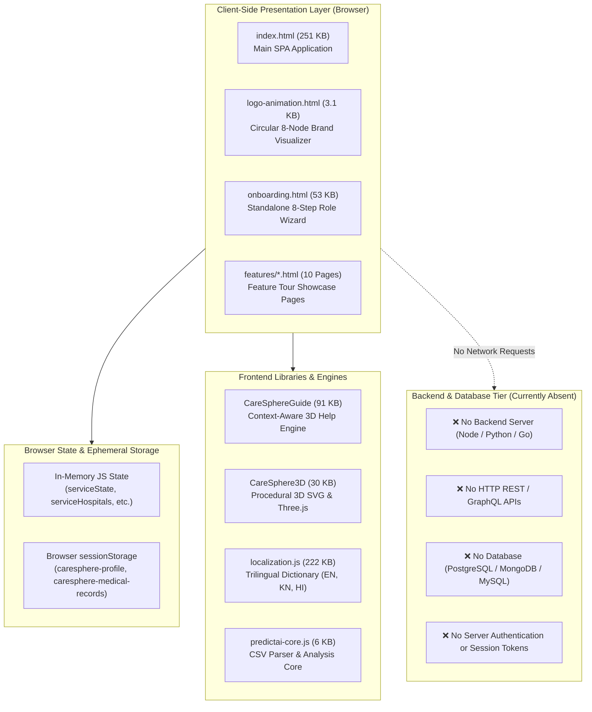
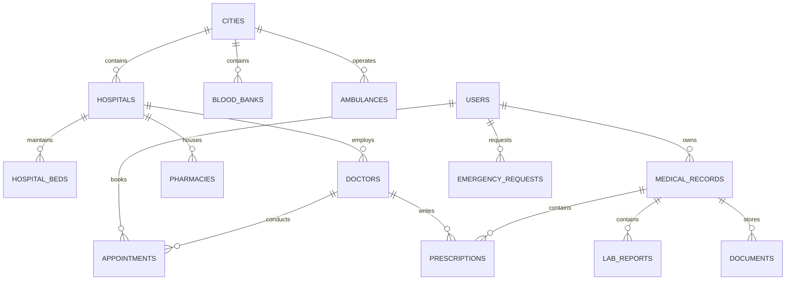
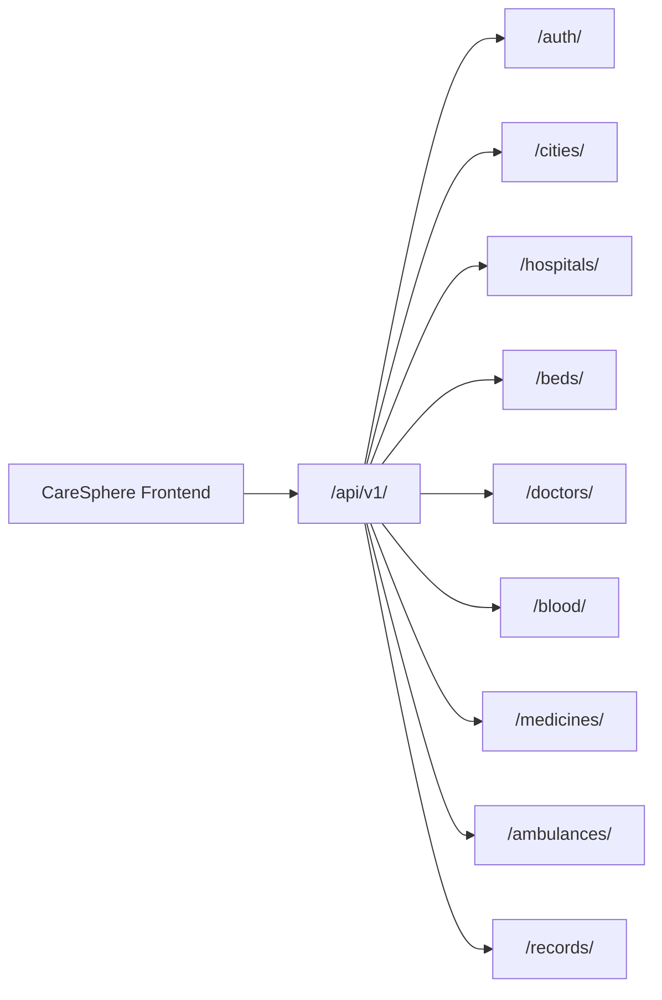
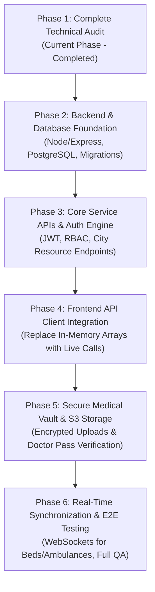

# CARESPHERE — PHASE 1: COMPLETE TECHNICAL AUDIT REPORT

**Date:** November 18, 2026  
**Project:** CareSphere – AI-Powered, City-Based Integrated Government Healthcare Resource Management and Assistance Platform  
**Target City:** Bengaluru (Initial Active Node), with multi-city expansion architecture  
**Repository Branch:** `main`  
**Audit Status:** Complete (Read-Only Inspection; No Code/Data Modified)

---

## 1. Current Project Architecture

CareSphere is currently structured as an advanced, high-fidelity **Client-Side Single Page Application (SPA)** with zero server-side infrastructure or database connectivity.



### Architectural Breakdown
1. **Frontend Architecture:**
   - **Root SPA (`index.html`):** Monolithic client-side bundle containing complete UI view templates, routing state engine (`serviceState`), modal controllers, filter handlers, and sample dataset definitions.
   - **Showcase Module (`features/`):** 10 modular HTML pages (`bed-availability.html`, `hospital-availability.html`, `doctor-directory.html`, etc.) driven by `features-data.js` and `feature-pages.js` for standalone feature demonstrations.
   - **Styling Architecture:** Modern, accessible CSS3 utilizing custom properties (`--blue`, `--teal`, `--canvas`, `--ink`), responsive flexbox/grid layouts, high-contrast text (`#0F172A`, `#334155`), and WCAG-aligned focus states.
   - **Internationalization Engine (`assets/localization.js`):** Client-side dictionary supporting English, Kannada (ಕನ್ನಡ), and Hindi (हिन्दी) for static strings and labels.
2. **Data & Storage Layer:**
   - All healthcare resource data (hospitals, beds, doctors, medicines, ambulances, blood stock) is declared as hardcoded in-memory JavaScript array constants.
   - User profile details, active city selection, and medical vault records are saved strictly into the browser's transient `sessionStorage`.
3. **Backend & Persistence Layer:**
   - There is currently **no backend server**, **no API framework**, **no database engine**, and **no network data transport**.

---

## 2. Completed Features

The following capabilities are fully designed, visually complete, interactive, and functional on the client side:

* **Interactive Brand Intro & Circular Healthcare Visualization:**
  - 8-node animated circular healthcare network wheel with pulsing status lights, smooth rotation, live language switching (EN, KN, HI), and clean transition to onboarding.
* **Intelligent Context-Aware 3D User Guide:**
  - Dedicated drawer interface (`assets/caresphere-guide.js`) with procedural 3D SVG and Three.js assistant canvas.
  - Dynamically updates guidance, FAQs, and common mistakes based on active route and active user role.
  - Darkened typography and high-contrast guidance cards scoped exclusively to the main dashboard.
* **City Engine Interface & Bengaluru Node Configuration:**
  - Interactive topbar location badge displaying current city.
  - Modal city switcher dialog displaying active node (Bengaluru) and upcoming network nodes (Mysuru, Mumbai, Delhi, Chennai, Hyderabad).
  - Ability for users to type and register a custom city/town/village during onboarding.
* **Onboarding & Role Picker Engine:**
  - 8-step wizard supporting 9 distinct user roles (Patient, Doctor, Nurse, Hospital, Ambulance, Blood Bank, Supplier, Government, Admin).
  - Clear mandatory field indicators (`*`), accessible legend, and real-time field validation.
  - Vertical card layout for Consent & Privacy checkboxes with active selection states.
* **UI Presentation for All Seven Core Services:**
  - Search, filter chips, category dropdowns, status indicators, and modal dialogs for all 7 modules in `index.html`.

---

## 3. Partially Completed Features

These features function visually in the browser interface but rely on ephemeral client-side mocks or lack backend backing:

1. **City-Based Resource Filtering:**
   - Filtering works in-memory for Bengaluru (`h.city === city.id`). However, selecting any upcoming city displays an empty onboarding placeholder card with no live facility connection.
2. **Unified Search Engine:**
   - Real-time client-side substring matching across in-memory arrays. Lacks server-side full-text search, typo-tolerance, semantic search, or database indexing.
3. **Staff Simulation Portals:**
   - Interactive modals for hospital staff ("Update Beds"), blood bank staff ("Update Stock"), and pharmacy staff ("Update Medicine Stock").
   - These update the in-memory JavaScript objects in real-time, but **all updates vanish upon page reload**.
4. **Clinician Access Pass (6-Digit Token):**
   - Generates a temporary pass code (`CS-XXXXXX`) with a 15-minute expiration timestamp saved in `sessionStorage`. Works visually, but cannot be verified by a doctor on another device because no verification API exists.
5. **Medical Document Upload:**
   - File selector accepts document selection, but only saves document metadata (`name`, `category`, `date: Today`, `size: 350 KB`) to `sessionStorage`. The physical file bytes are not uploaded or stored.
6. **Appointment Booking Request:**
   - Validates consultation date, time slot, and reason, shows a confirmation toast, but does not store an appointment record or alert healthcare staff.
7. **Emergency Dispatch Request & Tracking:**
   - Collects pickup address and emergency type, transitions into an animated `ambulance-tracking` view with simulated route status and ETA, but lacks GPS telemetry, websocket dispatch, and live driver communication.

---

## 4. Missing Features

To transition from a frontend prototype to a production government healthcare platform, the following components must be built:

* **Production Backend Service:** RESTful or GraphQL API server (e.g., Node.js/Express or Python/FastAPI).
* **Persistent Database:** Production database (PostgreSQL or MongoDB) to store verified healthcare resources, user profiles, audit logs, and medical records.
* **Authentication & Authorization System:** Cryptographic user authentication (bcrypt password hashing, JWT/HttpOnly session cookies), OTP/SMS verification, and OAuth/Government SSO integration.
* **Role-Based Access Control (RBAC):** Server-enforced permissions ensuring only verified hospital administrators can alter bed numbers, only verified blood bank officers can edit blood units, and only patients can grant access to medical records.
* **HIPAA/DISHA Compliant File Vault:** S3/GCS or encrypted object storage for actual diagnostic PDF reports, prescriptions, and lab scans.
* **Real-Time Telemetry & Event Engine:** WebSockets or Server-Sent Events (SSE) for live hospital bed availability sync and emergency ambulance tracking.

---

## 5. Backend and Database Status

| Area | Current Repository Status | Target Production Requirement |
| :--- | :--- | :--- |
| **Backend Framework** | **None** (100% static client files) | Node.js (Express / Fastify) or Python (FastAPI) |
| **Server Entry Point** | **None** (Files run via static browser file protocol) | `server.js` or `main.py` listening on dedicated port |
| **API Endpoints** | **None** (0 network fetch calls found in code) | RESTful API (`/api/v1/...`) with JSON payloads |
| **Database Engine** | **None** | PostgreSQL (Relational) or MongoDB (Document) |
| **Persistence** | Browser `sessionStorage` (lost on tab close / browser clear) | ACID-compliant persistent database storage |
| **Authentication** | Visual dropdown selection (no credentials verified) | JWT + Secure HttpOnly Cookies + Password Hashing |
| **File Storage** | Fake metadata array item in `sessionStorage` | Encrypted cloud object storage (AWS S3 / GCP Storage / MinIO) |

---

## 6. Seven-Module Functionality Matrix

| Module | Existing UI Functionality | Current Data Source | API Status | Database Status | Working Features | Non-Working / Simulated Features | Security & Validation Gaps |
| :--- | :--- | :--- | :--- | :--- | :--- | :--- | :--- |
| **1. Hospital Availability** | Directory view, search filter, facility chips, contact hotline, distance badges. | Hardcoded `serviceHospitals` array (3 Bengaluru hospitals). | No API | No Database | Card rendering, name/facility filtering, distance sorting, details modal. | Live distance GPS calculation, real facility sync, directions routing. | Hospital details can be spoofed in memory; unauthenticated endpoints. |
| **2. Bed Availability** | Capacity meters for General, ICU, Emergency beds; occupancy %; last updated. | `serviceHospitals[i].beds` object mapping. | No API | No Database | Visual capacity bars, bed category filtering (General, ICU, Emergency), sort by occupancy. | Live bed reservation, automatic bed occupancy sync, hospital EHR integration. | "Staff: Update Beds" simulation can be triggered by any unauthenticated visitor. |
| **3. Doctor Availability** | Doctor profiles, specialty filter, working hours, hospital affiliation, appointment modal. | Hardcoded `serviceDoctors` array (3 Bengaluru doctors). | No API | No Database | Specialty dropdown filter, doctor card details, consultation request modal validation. | Persistent appointment booking, doctor schedule calendar sync, doctor confirmation notifications. | No doctor verification; patient requests vanish upon modal close. |
| **4. Blood Availability** | Stock search by blood group (`A+` to `O−`), unit counters, donor compatibility guidance. | Hardcoded `bloodAvailability` array (5 stock entries). | No API | No Database | Group matching, compatibility indicator, stock status pills (Available/Limited/Unavailable). | Live blood bank inventory sync, donor registration, urgent blood request broadcasts. | Anyone can click "Staff: Update Units" and alter blood stock numbers without authorization. |
| **5. Medicine Availability** | Medicine search, provider type filter (Hospital pharmacy vs Jan Aushadhi), stock quantities. | Hardcoded `serviceMedicines` array (4 medicines). | No API | No Database | Text search by drug name, filter by availability, distance tags. | Batch tracking, expiry date monitoring, distributor supply chain orders, prescription-bound validation. | No prescription verification check prior to checking restricted medicines. |
| **6. Ambulance Services** | ALS/BLS fleet listing, ETA estimates, 24/7 hotline dialer, emergency booking form, tracking screen. | Hardcoded `serviceAmbulances` array (3 response units). | No API | No Database | Form validation (pickup, emergency type, contact), transition to animated tracking page. | Live GPS vehicle tracking, automated dispatch algorithm, driver mobile terminal communication. | Fake emergency alerts can be dispatched without phone verification; no authentication. |
| **7. Medical Records Management** | Tabbed citizen health vault (Profile, Prescriptions, Lab Reports, Consultations, Documents, Clinician Pass). | `defaultMedicalRecords` merged with `sessionStorage["caresphere-medical-records"]`. | No API | No Database | Reading mock records, viewing detailed lab metrics modal, generating 6-digit access code, revoking code. | Actual PDF file storage, doctor remote viewing from separate session, lab EHR direct report push. | Records stored in plaintext `sessionStorage`; no zero-knowledge encryption; accessible by any browser script. |

---

## 7. Security and Validation Gaps

1. **Client-Side Role Spoofing:**
   - Any user can switch their role to "Doctor", "Hospital Staff", or "System Administrator" via the UI dropdown. Role-based privileges are purely cosmetic and lack backend enforcement.
2. **Unprotected Health Information (PHI):**
   - Personal medical conditions, allergies, and prescriptions are stored unencrypted in browser `sessionStorage`. Any cross-site script (XSS) or local browser extension can access this data.
3. **Absence of Authentication & Session Management:**
   - No password verification, no multi-factor authentication (MFA), and no session invalidation. Anyone with access to the browser tab has full access.
4. **Staff Simulation Exposure:**
   - Simulation action buttons ("Staff: Update Beds", "Staff: Update Stock") are accessible directly on public citizen views.
5. **No File Integrity or Malware Scanning:**
   - Medical document uploads lack MIME-type validation, size enforcement, virus scanning, and authenticated access control.

---

## 8. Recommended Database Structure

To build a reliable government-scale platform, a relational database (such as **PostgreSQL**) is strongly recommended for strict referential integrity across healthcare transactions, with schemas structured as follows:



### Core Relational Schemas

```sql
-- 1. City & Administrative Nodes
CREATE TABLE cities (
    id VARCHAR(50) PRIMARY KEY, -- e.g. 'bengaluru'
    name VARCHAR(100) NOT NULL,
    state VARCHAR(100) NOT NULL,
    district VARCHAR(100) NOT NULL,
    status VARCHAR(20) DEFAULT 'active', -- 'active' | 'upcoming'
    latitude DECIMAL(9,6),
    longitude DECIMAL(9,6),
    created_at TIMESTAMP WITH TIME ZONE DEFAULT NOW()
);

-- 2. User & Authentication
CREATE TABLE users (
    id UUID PRIMARY KEY DEFAULT gen_random_uuid(),
    full_name VARCHAR(150) NOT NULL,
    mobile VARCHAR(20) UNIQUE NOT NULL,
    email VARCHAR(150) UNIQUE,
    password_hash VARCHAR(255) NOT NULL,
    role VARCHAR(30) NOT NULL, -- 'patient'|'doctor'|'nurse'|'hospital'|'ambulance'|'blood'|'supplier'|'admin'
    city_id VARCHAR(50) REFERENCES cities(id),
    gender VARCHAR(20),
    date_of_birth DATE,
    address TEXT NOT NULL,
    pin_code VARCHAR(10) NOT NULL,
    is_verified BOOLEAN DEFAULT FALSE,
    created_at TIMESTAMP WITH TIME ZONE DEFAULT NOW()
);

-- 3. Hospitals & Bed Inventory
CREATE TABLE hospitals (
    id VARCHAR(100) PRIMARY KEY,
    city_id VARCHAR(50) REFERENCES cities(id) NOT NULL,
    name VARCHAR(200) NOT NULL,
    hospital_type VARCHAR(100) NOT NULL, -- 'Government hospital' | 'Public teaching hospital' | etc.
    address TEXT NOT NULL,
    phone VARCHAR(30) NOT NULL,
    emergency_24x7 BOOLEAN DEFAULT TRUE,
    latitude DECIMAL(9,6),
    longitude DECIMAL(9,6),
    created_at TIMESTAMP WITH TIME ZONE DEFAULT NOW()
);

CREATE TABLE hospital_beds (
    id UUID PRIMARY KEY DEFAULT gen_random_uuid(),
    hospital_id VARCHAR(100) REFERENCES hospitals(id) ON DELETE CASCADE,
    bed_type VARCHAR(50) NOT NULL, -- 'General' | 'ICU' | 'Emergency' | 'Pediatric' | 'Maternity' | 'Isolation'
    total_capacity INT NOT NULL DEFAULT 0,
    available_beds INT NOT NULL DEFAULT 0,
    last_updated_by UUID REFERENCES users(id),
    updated_at TIMESTAMP WITH TIME ZONE DEFAULT NOW()
);

-- 4. Doctors & Consultation Schedules
CREATE TABLE doctors (
    id VARCHAR(100) PRIMARY KEY,
    user_id UUID REFERENCES users(id),
    hospital_id VARCHAR(100) REFERENCES hospitals(id),
    name VARCHAR(150) NOT NULL,
    specialty VARCHAR(100) NOT NULL,
    qualification VARCHAR(150) NOT NULL,
    department VARCHAR(100),
    working_hours VARCHAR(100),
    status VARCHAR(50) DEFAULT 'Available',
    created_at TIMESTAMP WITH TIME ZONE DEFAULT NOW()
);

CREATE TABLE appointments (
    id UUID PRIMARY KEY DEFAULT gen_random_uuid(),
    patient_id UUID REFERENCES users(id) NOT NULL,
    doctor_id VARCHAR(100) REFERENCES doctors(id) NOT NULL,
    hospital_id VARCHAR(100) REFERENCES hospitals(id) NOT NULL,
    appointment_date DATE NOT NULL,
    time_slot VARCHAR(50) NOT NULL,
    reason TEXT,
    status VARCHAR(30) DEFAULT 'Pending', -- 'Pending' | 'Confirmed' | 'Completed' | 'Cancelled'
    created_at TIMESTAMP WITH TIME ZONE DEFAULT NOW()
);

-- 5. Blood Bank Inventory
CREATE TABLE blood_banks (
    id VARCHAR(100) PRIMARY KEY,
    hospital_id VARCHAR(100) REFERENCES hospitals(id),
    city_id VARCHAR(50) REFERENCES cities(id) NOT NULL,
    name VARCHAR(200) NOT NULL,
    phone VARCHAR(30) NOT NULL,
    address TEXT NOT NULL
);

CREATE TABLE blood_inventory (
    id UUID PRIMARY KEY DEFAULT gen_random_uuid(),
    blood_bank_id VARCHAR(100) REFERENCES blood_banks(id) ON DELETE CASCADE,
    blood_group VARCHAR(10) NOT NULL, -- 'A+', 'A−', 'B+', 'B−', 'AB+', 'AB−', 'O+', 'O−'
    available_units INT NOT NULL DEFAULT 0,
    updated_at TIMESTAMP WITH TIME ZONE DEFAULT NOW(),
    CONSTRAINT unique_bank_group UNIQUE (blood_bank_id, blood_group)
);

-- 6. Pharmacy & Medicines
CREATE TABLE pharmacies (
    id VARCHAR(100) PRIMARY KEY,
    hospital_id VARCHAR(100) REFERENCES hospitals(id),
    city_id VARCHAR(50) REFERENCES cities(id) NOT NULL,
    name VARCHAR(200) NOT NULL,
    provider_type VARCHAR(100) NOT NULL, -- 'Hospital pharmacy' | 'Jan Aushadhi Kendra' | 'Authorized supplier'
    address TEXT NOT NULL
);

CREATE TABLE medicine_inventory (
    id UUID PRIMARY KEY DEFAULT gen_random_uuid(),
    pharmacy_id VARCHAR(100) REFERENCES pharmacies(id) ON DELETE CASCADE,
    name VARCHAR(150) NOT NULL,
    strength VARCHAR(50) NOT NULL,
    dosage_form VARCHAR(50) NOT NULL, -- 'Tablet' | 'Capsule' | 'IV Bottle' | 'Syrup'
    stock_status VARCHAR(30) NOT NULL, -- 'Available' | 'Limited' | 'Unavailable'
    quantity_description VARCHAR(100),
    updated_at TIMESTAMP WITH TIME ZONE DEFAULT NOW()
);

-- 7. Ambulance Response Fleet
CREATE TABLE ambulances (
    id VARCHAR(50) PRIMARY KEY, -- Plate number e.g. 'KA-01-AB-1234'
    city_id VARCHAR(50) REFERENCES cities(id) NOT NULL,
    provider VARCHAR(150) NOT NULL,
    ambulance_type VARCHAR(100) NOT NULL, -- 'Advanced Life Support' | 'Basic Life Support' | 'Patient Transport'
    phone VARCHAR(30) NOT NULL,
    status VARCHAR(30) DEFAULT 'Available', -- 'Available' | 'On Trip' | 'Maintenance'
    current_lat DECIMAL(9,6),
    current_lng DECIMAL(9,6),
    updated_at TIMESTAMP WITH TIME ZONE DEFAULT NOW()
);

CREATE TABLE emergency_dispatches (
    id UUID PRIMARY KEY DEFAULT gen_random_uuid(),
    patient_id UUID REFERENCES users(id),
    ambulance_id VARCHAR(50) REFERENCES ambulances(id),
    pickup_address TEXT NOT NULL,
    destination_hospital_id VARCHAR(100) REFERENCES hospitals(id),
    emergency_type VARCHAR(100) NOT NULL,
    contact_phone VARCHAR(30) NOT NULL,
    dispatch_status VARCHAR(50) DEFAULT 'Dispatched', -- 'Requested' | 'Dispatched' | 'En Route' | 'Arrived' | 'Completed'
    created_at TIMESTAMP WITH TIME ZONE DEFAULT NOW()
);

-- 8. Personal Medical Vault
CREATE TABLE medical_profiles (
    user_id UUID PRIMARY KEY REFERENCES users(id) ON DELETE CASCADE,
    blood_group VARCHAR(10),
    allergies TEXT,
    chronic_conditions TEXT,
    emergency_contact TEXT,
    updated_at TIMESTAMP WITH TIME ZONE DEFAULT NOW()
);

CREATE TABLE medical_documents (
    id UUID PRIMARY KEY DEFAULT gen_random_uuid(),
    user_id UUID REFERENCES users(id) ON DELETE CASCADE,
    title VARCHAR(200) NOT NULL,
    category VARCHAR(100) NOT NULL, -- 'Prescription' | 'Lab Report' | 'Discharge Summary' | 'Immunization'
    storage_path VARCHAR(500) NOT NULL,
    file_size_bytes BIGINT NOT NULL,
    mime_type VARCHAR(100) NOT NULL,
    uploaded_at TIMESTAMP WITH TIME ZONE DEFAULT NOW()
);

CREATE TABLE clinician_access_passes (
    id UUID PRIMARY KEY DEFAULT gen_random_uuid(),
    patient_id UUID REFERENCES users(id) ON DELETE CASCADE,
    pass_code VARCHAR(20) UNIQUE NOT NULL, -- e.g. 'CS-849201'
    expires_at TIMESTAMP WITH TIME ZONE NOT NULL,
    is_revoked BOOLEAN DEFAULT FALSE,
    accessed_by_doctor_id VARCHAR(100) REFERENCES doctors(id),
    created_at TIMESTAMP WITH TIME ZONE DEFAULT NOW()
);
```

---

## 9. Recommended API Structure

A clean, RESTful API architecture partitioned by service domain:



### Endpoints Specification

#### A. Authentication & User Profile
- `POST /api/v1/auth/register` — Register citizen/staff with role, city, and address.
- `POST /api/v1/auth/login` — Authenticate and issue secure JWT / session cookie.
- `GET  /api/v1/auth/me` — Retrieve authenticated user profile and permissions.
- `POST /api/v1/auth/logout` — Invalidate session tokens.

#### B. City Engine
- `GET  /api/v1/cities` — List all supported and upcoming healthcare cities.
- `GET  /api/v1/cities/:cityId/summary` — Aggregate statistics for selected city.

#### C. Hospital & Bed Availability
- `GET  /api/v1/hospitals?city=bengaluru&facility=ICU` — Query hospitals with search & filters.
- `GET  /api/v1/hospitals/:id` — Detailed hospital profile and facility list.
- `GET  /api/v1/beds/availability?city=bengaluru&type=ICU` — City-wide live bed counts.
- `PATCH /api/v1/beds/update` — Authorized hospital staff endpoint to update capacities.

#### D. Doctor Availability & Appointments
- `GET  /api/v1/doctors?city=bengaluru&specialty=Cardiology` — Search verified doctors.
- `GET  /api/v1/doctors/:id/slots?date=2026-11-20` — Available consultation slots.
- `POST /api/v1/appointments/book` — Patient consultation booking endpoint.

#### E. Blood Availability
- `GET  /api/v1/blood/stock?city=bengaluru&group=O+` — Query blood stock across city banks.
- `PATCH /api/v1/blood/stock/update` — Authorized blood bank staff update endpoint.

#### F. Medicine Availability
- `GET  /api/v1/medicines?city=bengaluru&query=Paracetamol` — Search pharmacy drug inventories.
- `PATCH /api/v1/medicines/stock/update` — Pharmacy supplier stock updater.

#### G. Ambulance Services
- `GET  /api/v1/ambulances?city=bengaluru&type=ALS` — List active response fleet and ETAs.
- `POST /api/v1/ambulances/request` — Emergency assistance dispatch request.
- `GET  /api/v1/ambulances/tracking/:dispatchId` — Live dispatch status and telemetry.

#### H. Medical Records Management Vault
- `GET  /api/v1/records/me` — Patient-authenticated access to personal health vault.
- `POST /api/v1/records/documents/upload` — Multipart file upload (prescriptions/reports).
- `GET  /api/v1/records/documents/:id/download` — Secure, signed URL document download.
- `POST /api/v1/records/access-pass/generate` — Generate temporary 6-digit clinician pass.
- `POST /api/v1/records/access-pass/verify` — Doctor redemption of 6-digit pass to view records.
- `POST /api/v1/records/access-pass/revoke` — Instant revocation of doctor pass.

---

## 10. Prioritized Development Roadmap



### Detailed Execution Phases

* **Phase 1: Architecture & Technical Audit (Completed in this turn)**
  - Comprehensive source code audit, dependency scan, security gap analysis, and database/API architectural specification.
* **Phase 2: Backend Server & Database Foundation**
  - Set up a clean, lightweight Node.js/Express (or Python/FastAPI) backend service.
  - Implement PostgreSQL database with the schema defined in Section 8.
  - Seed baseline verified data for Bengaluru (hospitals, beds, doctors, medicines, blood banks, ambulances).
* **Phase 3: Core Service REST APIs & Authentication**
  - Implement authentication (`/api/v1/auth/*`) with password hashing and JWT cookies.
  - Implement REST endpoints for City selection, Hospitals, Beds, Doctors, Blood, Medicines, and Ambulances.
  - Enforce server-side role-based authorization for staff update routes.
* **Phase 4: Frontend API Client Integration**
  - Connect the existing `index.html` frontend views to live backend endpoints via standard `fetch()` API client layer.
  - Maintain the exact existing branding, animations, 3D User Guide, and responsive layout without visual regression.
  - Graceful offline fallback to demo data if the server is unreachable.
* **Phase 5: Secure Medical Vault & Document Storage**
  - Implement multipart file upload for medical documents with cloud/local encrypted storage.
  - Implement live cross-session Clinician Access Pass verification (doctor inputs pass from their workstation to view authorized patient records).
* **Phase 6: Live Synchronization & End-to-End Testing**
  - WebSockets or SSE for real-time bed count updates and ambulance dispatch simulation.
  - Automated integration testing suite covering auth, city filtering, data persistence, and health privacy controls.
