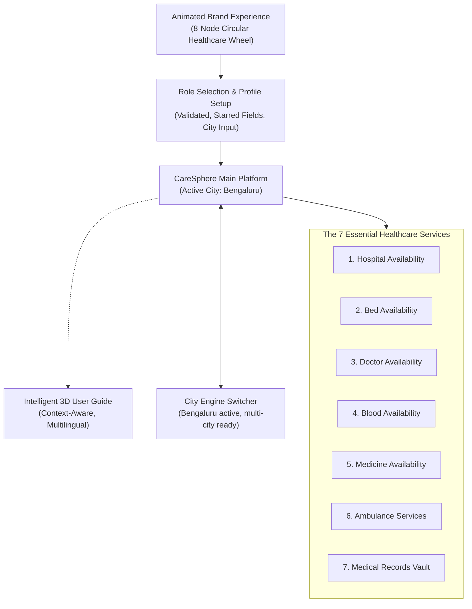
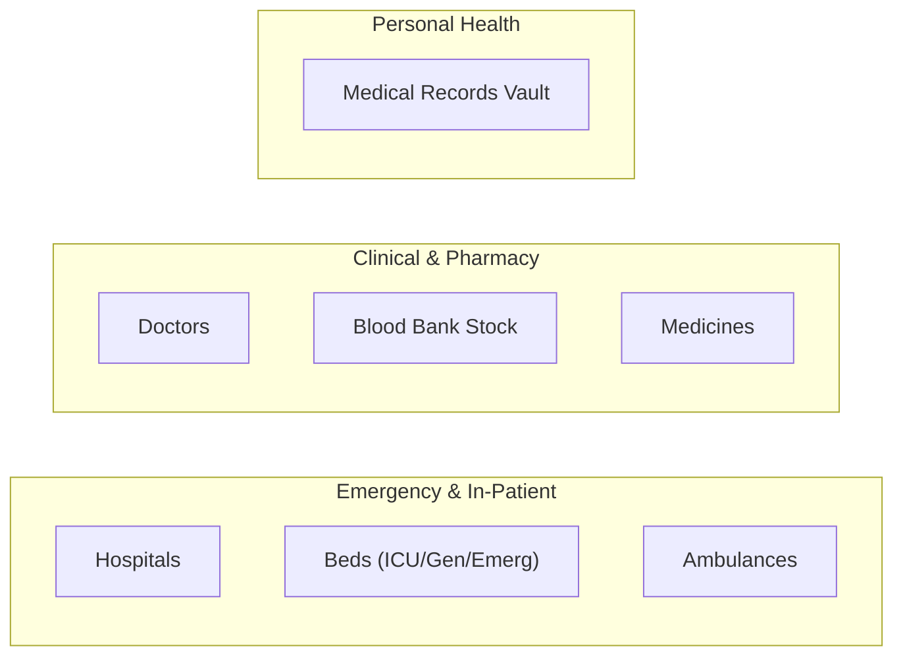

# CareSphere — Comprehensive Project Progress & Status Report

**Platform:** CareSphere – AI-Powered, City-Based Integrated Government Healthcare Resource Management and Assistance Platform  
**Repository Branch:** `main` (synchronized with `origin/main`)  
**Report Date:** November 18, 2026  

---

## 1. Executive Summary

Over the course of the project development sessions, CareSphere has evolved from an initial concept prototype into a refocused, high-contrast, city-based integrated healthcare platform. The system is strictly structured around **seven core public healthcare services**, backed by an intelligent context-aware 3D user guide, an interactive 8-node system brand visualization, a modular city engine, and an accessible, validated user onboarding flow.

---

## 2. Chronological Milestones & Commit History

| Commit | Summary | Core Changes |
| :--- | :--- | :--- |
| `9d33996` | **Form & City Engine Refinements** | Removed "Prefer not to say" across all forms, added custom city/town/village input option, made address required with `*`, and stacked consent checkboxes vertically. |
| `9c6751d` | **Care Guide Scoping to Main App** | Restricted Care Guide exclusively to the main platform page (removed onboarding interruptions and hidden during intro via MutationObserver). |
| `3892489` | **Streamlined Brand Experience** | Removed "Explore as a patient" and "Skip animation" buttons to enforce intentional onboarding. |
| `3253e08` | **Mandatory Star Indicators & Legends** | Added red asterisk (`*`) and accessible legend across all mandatory registration and action forms. |
| `0ec8ea8` | **Refocus on 7 Core Services** | Pruned extraneous modules; rebuilt interface and state strictly around the 7 essential services and city-level routing. |
| `f961bdd` | **3D User Guide & Contrast Overhaul** | Built the dynamic Three.js/SVG 3D interactive guide, restored the 8-node animated wheel, and fixed text contrast. |
| `fac2960` | **PredictAI & Verification Suite** | Implemented source-aware prediction logic and automated test suites. |
| `8eb12bd` | **CareSphere Initial Prototype** | Initial role-based UI and component layouts. |

---

## 3. The Seven Core Services Architecture

The platform architecture was refactored in `index.html` to eliminate unverified auxiliary features and focus exclusively on the 7 critical pillars:

1. **Hospital Availability:**
   - City-filtered directory with search, live distance calculation, emergency capability tags, and direct facility details.
2. **Bed Availability:**
   - Live availability tracking across **General**, **ICU**, and **Emergency** beds with occupancy percentages and last-updated timestamps.
3. **Doctor Availability:**
   - Specialists searchable by discipline, hospital affiliation, consultation hours, and appointment request modal.
4. **Blood Availability:**
   - Stock inventory by blood group (`A+`, `A−`, `B+`, `B−`, `AB+`, `AB−`, `O+`, `O−`) across verified city blood banks.
5. **Medicine Availability:**
   - Searchable pharmacy inventory displaying item name, dosage form, provider location, and verified stock status.
6. **Ambulance Services:**
   - Emergency response fleet directory with dispatch contact details, estimated time of arrival (ETA), and direct emergency request modal.
7. **Medical Records Management Vault:**
   - Secure personal health dashboard featuring patient medical profile, consultation logs, prescription history, lab reports, and document upload capabilities.

---

## 4. Key Systems Developed & Enhanced

### A. Intelligent Context-Aware 3D User Guide
- **Source Files:** `assets/caresphere-guide.js`, `assets/caresphere-3d.js`
- **Context-Aware Engine:** Dynamically adapts help content based on the active route/module (Hospitals, Beds, Doctors, Blood, Medicines, Ambulances, Records) and user role (Patient, Doctor, Nurse, Hospital Staff, etc.).
- **Interactive 3D Assistant:** Floating 3D healthcare guide with procedural 3D SVG fallbacks and Three.js rendering for high compatibility without bulky external assets.
- **High-Contrast Design:** Darkened navy/slate typography (`#0F172A`, `#334155`), high-contrast guidance cards, and full trilingual support (English, Kannada, Hindi).
- **Placement:** Restricted strictly to the main dashboard home page with no modal popups interrupting onboarding.

### B. Animated Circular Brand Visualization
- **Source Files:** `logo-animation.html`, `assets/logo-animation.js`
- Fully restored and stabilized 8-node circular healthcare network wheel with pulsing status indicators, language toggle (English, Kannada, Hindi), smooth canvas rendering, and streamlined single-action transition into the platform.

### C. City Engine & Multi-City Readiness
- **Active City:** **Bengaluru** configured as the primary active healthcare node.
- **Upcoming Nodes:** Architecture built to expand to Mysuru, Mumbai, Delhi, Chennai, and Hyderabad without refactoring.
- **City Switcher:** Interactive topbar badge and city modal allowing manual city selection and live service data filtering.
- **Custom City Registration:** Users can enter their own village/town/city name during onboarding, which dynamically registers into the session city engine.

### D. Registration & Onboarding Overhaul
- **Source Files:** `index.html`, `onboarding.html`
- **Mandatory Field Indicators:** Clear red asterisks (`*`) and explanatory legends on required inputs.
- **Removed "Prefer not to say":** Cleaned from Gender, Blood Group, Medical Conditions, Organ Donor, and Health Insurance dropdowns.
- **Mandatory Address:** Address field marked required with validation.
- **Vertical Consent & Privacy:** Re-architected consent checkboxes into full-width card containers stacked one below the other with clear spacing and active focus states.

---

## 5. Quality Assurance & Verification

- **Automated Tests:** `assets/predictai-core.test.js` passes 4/4 test suites (CSV observation parsing, edge cases, malformed quoting, schema verification).
- **Script Syntax:** All inline and external scripts in `index.html` and `onboarding.html` validated with 0 syntax errors.
- **Git Repository:** Working tree clean; all changes committed and synchronized with remote repository `origin/main`.
